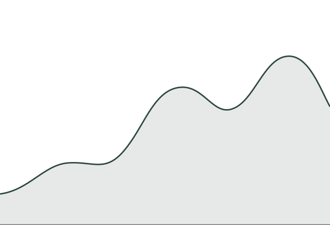
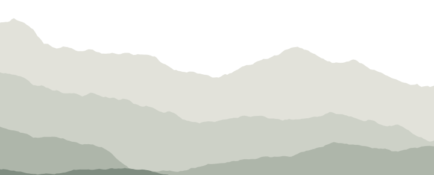

## Overview

::: {.trail}
- Introduction
- Background
- Methods
- Results
- Discussion
- Questions
:::

# Into the woods

Level-one headings open a new section on a dark contour map.

## Lists, columns & fragments

:::: {.columns}

::: {.column}
- Small, quiet bullets in pine
- **Bold**, *italic*, [a link](https://quarto.org) and `code`
- Nested lists
  - step down in size and weight
  - with [highlighted]{.mark} text
:::

::: {.column}
::: {.incremental}
1. Start at the trailhead
2. Follow the markers
3. The current fragment
4. Still ahead
:::
:::

::::

## Code & output

:::: {.columns}

::: {.column width="58%"}
```{.r filename="elevation.R" code-line-numbers="3-4"}
library(ggplot2)

trail <- read.csv("data/trail.csv")
ggplot(trail, aes(distance, elevation)) +
  geom_area(alpha = 0.4) +
  theme_minimal() # pairs well
```
:::

::: {.column width="42%"}
{fig-alt="An elevation profile rising towards the right"}
:::

::::

## Callouts

::: {.callout-grid}

::: {.callout-note}
## Note
Context worth a pause, in lake blue.
:::

::: {.callout-tip}
## Tip
A shortcut or a better route, in moss.
:::

::: {.callout-warning}
## Warning
Loose ground ahead, in ochre.
:::

::: {.callout-important}
## Important
The one thing to take home, in pine.
:::

::: {.callout-caution}
## Caution
Trail closed; this can break things.
:::

:::

## Tables & figures

:::: {.columns}

::: {.column width="52%"}
| Element  | Treatment           | Size  |
|----------|---------------------|------:|
| Headings | Instrument Sans 500 | 44 px |
| Body     | Instrument Sans 400 | 24 px |
| Code     | IBM Plex Mono       | 16 px |
| Footer   | IBM Plex Mono       | 12 px |

: Rules only where they help, no fills[^rules]
:::

::: {.column width="48%"}
{fig-alt="Layered grey-green ridgelines"}
:::

::::

[^rules]: Footnotes gather here, small and out of the way.

::: {.aside}
An aside sits in the margin.
:::

## Overview

::: {.trail-profile}
- Introduction
- Background
- Methods
- [Results]{.here}
- Discussion
- Questions
:::

## Marks & notes

:::: {.columns}

::: {.column}
Next stop: [Results]{.sign}, then [Discussion]{.sign}. Lost the thread? Head back to [Methods]{.sign .back}.

::: {.signpost .small}
- [Slides](https://quarto.org/docs/presentations/revealjs/){time="2 min" level="easy"}
- [Paper](https://quarto.org/docs/authoring/front-matter.html){time="10 min" level="moderate"}
- [Code](https://github.com/quarto-dev/quarto-cli){time="30 min" level="difficult"}
:::
:::

::: {.column}
::: {.fieldnote}
An observation, a side story or a takeaway. A [blaze marks the one phrase]{.blaze} people should follow.
:::
:::

::::

## Where to next

::: {.signpost}
- [Documentation](https://quarto.org/docs/presentations/revealjs/){time="5 min" level="easy"}
- [Source code](https://github.com/quarto-dev/quarto-cli){time="15 min" level="moderate"}
- [Contribute](https://quarto.org/docs/extensions/){time="1 h" level="difficult"}
:::

::: {.signpost-legend}
[easy]{.easy} [moderate]{.moderate} [difficult]{.difficult}
:::

# Results {.signpost .big time="20 min" level="moderate"}

An alternative section header: the heading is the sign, with an optional time and difficulty.

## A slide with a view {.bottom-mountains-1}

- Any ordinary slide can take one class
- The silhouette stays pale and behind the content
- Use it to break up a long run of text slides

## Thank you {.summit}

[quarto.org](https://quarto.org) · [@quarto_pub](https://fosstodon.org/@quarto)
